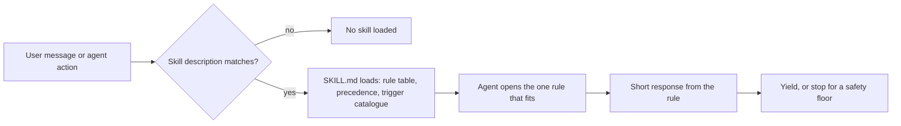

# operator-skills

A Claude Code plugin of 10 skills and 118 short rules that name common failures in agent-assisted coding and say what to do instead, plus 2 hooks. The rules are prompts. Five safety floors tell the agent to stop before a risky action. Nothing here is an enforcement control, and nothing here has been measured in a live session yet.

## Status, with evidence

| Question | Answer | Evidence |
|---|---|---|
| Does a rule change what the agent does in a live session? | Not measured. 0 sessions run. | A harness exists in [evals/](evals/README.md), not run. Running it calls a model API, which is the owner's decision. |
| Is the plugin well formed? | Yes, by a validator that opens every file. | 10 of 10 skills and 118 of 118 rules pass: valid YAML, every rule linked, all four rule sections, descriptions within Claude Code's listing cap. |
| Do the hooks follow the current Claude Code hook contract? | Yes, on fixtures. | 21 of 21 contract tests pass on temporary git repos, using payloads reconstructed from Claude Code 2.1.304 (not captured live). |
| What does the plugin cost in context before any skill fires? | About 2,019 tokens per session, down from about 8,556. | `claude plugin details operator-skills` (Claude Code's own estimate) before and after the description rewrite. |
| Does the visible skill text contain the intended words? | Partly. This is a lint, not routing accuracy. | Development data only: 7 of 28 shipped phrases, 5 of 28 should-fire probes, 30 of 30 stay-quiet probes. See [docs/EVALUATION.md](docs/EVALUATION.md). |

The earlier headline, "28 of 28 test phrases point to the intended rule", was a self-consistency check. The phrases matched strings that had been copied into skill metadata Claude Code never reads. Scored only on the text Claude Code can see, the same 28 phrases gave 12 of 28 before this branch.

## Problem

Long coding sessions with an AI agent fail in repeatable ways. The agent agrees with a weak plan three times in a row. It writes code against an API that does not exist. A quick fix widens into a different feature. A credential lands in a log. A cleanup rewrites forty thousand rows with no way back.

Each failure is easy to correct once someone names it. The trouble is that nobody names it at the moment it happens. These rules write the naming down so the agent can apply it when the situation appears.

## How it works



- Each skill is a `SKILL.md` whose short description starts with when not to use it, then names the situations. Claude Code shows at most 1,536 characters of a description, so the long trigger lists live in the SKILL.md body.
- Every rule file has the same four sections: the pattern, the response, when to stay quiet, and how the operator can override it. The validator enforces this.
- One precedence table ([docs/PRECEDENCE.md](docs/PRECEDENCE.md)) is copied into every SKILL.md. It sets four tiers, allows one correction per turn, and names an owner for each situation two rules both claim.

## Skills

| Skill | Failure it covers | Rules |
|---|---|---|
| `engineering-floor` | Safety floors (credentials, patient data, bulk data changes, schema changes, auth only in the UI) and everyday floors (errors, empty states, accessibility, contracts, tokens, tests, commit messages) | 21 |
| `claude-quality-watch` | Drift in Claude's own output: agreement without pushback, unverified APIs and claims, paraphrase drift, being led by momentum | 8 |
| `build-discipline` | Scope creep, polish before function, reopening shipped work, starting new work over unshipped work, missing briefs for substantial builds | 20 |
| `solo-run` | Unattended runs without a contract, stop conditions, log and debrief | 5 |
| `decision-discipline` | Options with no pick, unstated trade-offs, no kill criteria | 8 |
| `honesty-and-calibration` | Maturity claims without an outside user, dismissing an option without its strongest case | 4 |
| `claude-effective-usage` | Wrong surface or tool tier, serial calls that could be parallel, polling, stale context | 10 |
| `claude-usage-discipline` | Wrong channel, wrong source, session boundaries, parking ideas, repeated re-asks | 11 |
| `communication-craft` | Drafting: hedged asks, weak closings, apologies with "but", over-explaining | 23 |
| `strategy-and-business` | Business lenses: moats, unit economics, recurring spend | 8 |

Two of these skills (communication-craft and strategy-and-business, 31 of 118 rules) are general working advice, not coding checks. Decision-discipline and honesty-and-calibration (12 more) are general habits. A proposed split into a safety core and a general-advice plugin is open for the owner to decide.

## Safety floors

Tier 1 in the precedence table. These stop before the risky action and no mode or "explore" label switches them off.

- **secrets-walk:** a credential-shaped value in chat, tool output, code or logs. Do not repeat it, rotate it first if it might be real, then contain it.
- **phi-floor:** real-looking patient or personal data in prompts, fixtures, logs or commits. Do not copy it, ask whether it is real, offer a synthetic stand-in. Anything that could not be read is reported as "needs review", never as "none found".
- **migration-not-mutation:** a bulk UPDATE, DELETE, TRUNCATE, MERGE or ORM bulk call on existing rows. Count first, snapshot, use a transaction, try a sample, verify.
- **schema-discipline:** a change to the shape of stored data, including ORM schema files. Say what happens to existing rows, and keep "unknown" distinct from "none".
- **auth-floor:** an action guarded only in the UI. Check the server, and prove it with a request that should fail.
- The solo-run contract rules: no unattended run without scope, authority, stop conditions and an explicit go.

## Hooks

Both hooks are optional side effects of installing the plugin. Details, data written and the off switch are in [docs/HOOKS.md](docs/HOOKS.md).

- **Stop:** in a linked git worktree, warns once per session and commit when work is not in the default branch or is uncommitted. Squash and rebase merges count as merged. It prints no shell commands built from branch names.
- **SubagentStop:** writes one metadata line per subagent run to `~/.local/state/operator-skills/agent-activity.jsonl` (mode 600, outside the project). It never stores reply text.

## Examples

These are illustrations of the intended response, written by hand. They are not recordings, and no baseline has been observed, so they do not show that the agent would otherwise fail.

1. **A pasted key.** The operator pastes a `.env` block to ask why a deploy fails. One line holds a live-looking payment key. With secrets-walk the agent names the kind of value without repeating it, asks the operator to rotate the key if it is real, and keeps the value out of files and summaries.
2. **"Just run an UPDATE."** Forty thousand order rows have inconsistent status strings. With migration-not-mutation the agent counts the rows, proposes a snapshot table, a transaction with a check before commit and a five-row trial, and waits for agreement.
3. **An import that does not exist.** Asked for retry with backoff, the agent is about to import a helper from memory. With code-i-can-actually-run it checks the installed package's types, or runs the type checker, before relying on the import.

## Evidence and limits

- The validator, the routing lint, 21 hook contract tests, 8 validator fixture tests, 6 routing unit tests and 4 harness checks run with `npm test` on macOS and Linux in CI.
- The routing lint reads only text Claude Code can see. Its case files are development data: they were seen while the descriptions changed, so their numbers are development results, never a headline. A headline needs a fresh set written blind by someone who has not seen the rules, locked by checksum before its first run.
- Rules are prompts. They shape what the agent says and does when the agent applies them. They do not block anything. The hooks warn and record metadata. They do not enforce.
- Claude Code decides when to load a skill from its name and description. Whether it loads these at the right moments is not measured here.
- Many rules assume habits the operator may not have, such as a notes file. They now ask before writing any file.
- Rule content reflects one author's practice and was reviewed by four AI model families, not by an outside clinician panel or security team.

## Run locally

Requires Node 20 or later, git and jq. The eval harness also needs `sqlite3`.

```sh
git clone https://github.com/kvmadden/operator-skills.git
cd operator-skills
npm ci
npm test
claude --plugin-dir .
```

From inside Claude Code, to install from the marketplace:

```text
/plugin marketplace add kvmadden/operator-skills
/plugin install operator-skills@operator-skills-marketplace
```

Layout:

```text
.claude-plugin/   plugin and marketplace manifests
skills/<name>/    SKILL.md (description, rule table, precedence, trigger catalogue) and rules/
hooks/            Stop and SubagentStop hooks
docs/             precedence, evaluation, hooks, saved evidence
evals/            behavioral harness for claude plugin eval (not run)
tests/            validator, routing, hook contract and harness tests, development case files
tools/            validator, routing lint, precedence sync
```

## Development history

Built May to October 2026 in a private repository with personal notes and configuration, published as a cleaned snapshot (2 commits on main). The changes on this branch, their reasons and the review that prompted them are listed in [CHANGELOG.md](CHANGELOG.md).

## License

MIT, Kevin Madden, 2026. See [LICENSE](LICENSE). All examples, fixtures and test phrases are fictional or synthetic.
