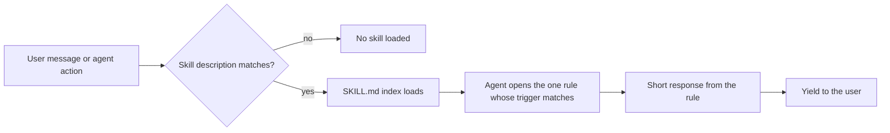

# operator-skills

A Claude Code plugin of 10 skills, 117 short rules and 2 hooks that each name one common failure in agent-assisted coding work and prescribe a specific correction.

## Problem

Long coding sessions with an AI agent fail in repeatable ways. The agent agrees with a weak plan three times in a row. It writes code against an API that does not exist. A "quick fix" widens into a different feature. A credential lands in a log. An unattended run drifts because nobody wrote down what it was allowed to do.

Each failure is easy to correct once someone names it. The trouble is that nobody names it at the moment it happens. This plugin writes the naming down as rules the agent can load when the matching situation appears, so the correction does not depend on the person remembering to ask for it.

## How it works



- Each skill is a `SKILL.md` with a `description` that lists the situations where it applies, plus a table that points to one file per rule in `rules/`.
- A rule file has the same shape every time: the pattern, the response (usually two to four lines), when to stay quiet (suppression), and how the user can override it.
- Two hooks ship with the plugin: `Stop` prints a warning when a session ends inside a git worktree under `.claude/worktrees/` that has commits not yet merged to `main` or `master`, and `SubagentStop` appends one JSON line per subagent run to `.claude/agent-activity.jsonl`.

| Skill | Failure it covers | Rules |
|---|---|---|
| `claude-quality-watch` | Agent drift: sycophancy, invented APIs and citations, unchecked claims about current state, being led by momentum | 8 |
| `engineering-floor` | Secrets in chat or repos, in-place data changes, auth only in the UI, missing error and empty states, vague commit messages | 20 |
| `build-discipline` | Output mistaken for outcome, missing brief, scope creep, polish before the feature works, starting another project | 20 |
| `decision-discipline` | Options with no pick, unstated trade-offs, no kill criteria, reversible and irreversible calls treated alike | 8 |
| `solo-run` | Unattended runs without a written contract, stop conditions, log and debrief | 5 |
| `honesty-and-calibration` | "Done" or "stable" claimed without outside use, rejecting an option without its strongest case | 4 |
| `claude-effective-usage` | Wrong surface or tool tier, serial tool calls that could be parallel, polling, stale context | 10 |
| `claude-usage-discipline` | Context and cost budgeting, handoffs, parking stray ideas, repeated re-prompts | 11 |
| `communication-craft` | Hedged asks, weak closings, apologies with "but", over-explaining, drafts that never pick a position | 23 |
| `strategy-and-business` | Moats, unit economics, cost versus investment, recurring spend | 8 |

## Examples

These three cases are illustrative. The scenarios are invented to show how a rule changes the agent's behavior. They are not recordings of real sessions and no outcome is measured.

### 1. A pasted key

- **Situation.** A user pastes a block of `.env` contents into the chat to ask why a deploy fails. One line holds a live-looking key beginning `sk_live_`.
- **Without the skill.** The agent quotes the block back while debugging, may copy the value into a test script, and the key now sits in the transcript and possibly in a commit.
- **Rule that fires.** `engineering-floor/secrets-walk`.
- **What changes.** The agent stops, does not repeat the value, and names only the pattern type ("looks like a payment-provider live key"). It asks the user to choose: this is a fake value, scrub and re-paste, or discuss moving it to an environment variable. Work resumes after the user answers.

### 2. "Just run an UPDATE"

- **Situation.** In a project database, 40,000 rows in an `orders` table have inconsistent `status` strings (`"shipped"`, `"Shipped "`, `"SHIPPED"`). The user says: "Let me just run an UPDATE on those rows to clean them up."
- **Without the skill.** The agent writes `UPDATE orders SET status = lower(trim(status))` and runs it. If the rule was wrong (for example, a legacy value that differed on purpose), the original strings are gone.
- **Rule that fires.** `engineering-floor/migration-not-mutation`.
- **What changes.** The agent declines to run the statement and walks the steps: snapshot the affected rows into a backup table, write an idempotent script, apply it to five rows and check them, run it on the full set, then re-query counts. It runs the work only after the user agrees to the plan.

### 3. An import that does not exist

- **Situation.** The user asks for retry-with-backoff around an HTTP call. The agent is about to write `import { retryWithBackoff } from 'axios'` from memory.
- **Without the skill.** The code looks plausible, is committed, and fails at runtime with an undefined import. The user spends time debugging a function that was never in the package.
- **Rule that fires.** `claude-quality-watch/code-i-can-actually-run`.
- **What changes.** Before writing the import, the agent checks the installed package (reading `node_modules/axios` and its type definitions). It finds no such export, tells the user so, and proposes either a small local helper or a separate retry package, naming which one it verified.

## Evidence

- `npm test` runs two scripts. `tools/validate-skills.mjs` checks the plugin and marketplace manifests, that every `SKILL.md` has frontmatter whose `name` matches its directory, that every rule link in a `SKILL.md` resolves, and that every hook command points at a file that exists. `tools/fire-test.mjs` runs the routing tests.
- The routing tests are 28 invented phrases in `tests/fire-test-phrases.json`, each paired with the skill and rule that should handle it. The script scores each phrase against the skill descriptions and rule triggers by keyword overlap and checks that the top result matches. This is a consistency check on the written descriptions. It does not measure how Claude Code routes in a live session.
- Result on 2026-10-30: 28 of 28 routing tests pass, and the validator reports 10 skills, 117 rules, valid manifests and hooks. `claude plugin validate` also passes on this directory.
- No measurement of speed, accuracy or user outcomes has been made. Nothing in this repository claims any.

## Design decisions and tradeoffs

- **One failure per rule file.** Small files keep the cost of an unused skill to its description and index. The tradeoff is 117 files to maintain and a risk that two rules overlap, so several descriptions say which neighbouring skill owns a given phrase.
- **Every rule has a suppression clause.** A correction that fires at the wrong time is noise. The tradeoff is more text per rule and more judgment for the agent about when to stay quiet.
- **Soft by default, hard for a few floors.** Most rules name the pattern and yield to the user. Secrets handling, in-place data changes, schema changes without a migration plan, and unattended runs without a contract do not proceed on "trust me". The tradeoff is that these can interrupt a user who knows the risk, so most rules list an explicit override.
- **Routing is described, then checked by a script.** The trigger phrases live in each skill's description, and a keyword-based test guards against regressions when descriptions change. The tradeoff is that a keyword test is a weak stand-in for real routing.
- **Content only.** The plugin has no runtime dependency beyond the two shell hooks. `package.json` exists for the test scripts.

## Limits

- It does not prove that a skill fires in a live session. Claude Code decides when to load a skill from its name and description, and that behavior is not tested here.
- Some rules assume files or habits the user may not have, such as a notes file, a run log or a project list. They say what to create when none exists, but the user must keep them.
- The `metadata` blocks (`promptSignals`, `pathPatterns`, `bashPatterns`) are read by the local routing test. they are not used for routing anywhere else in this repository.
- The `communication-craft` and `strategy-and-business` skills are general working advice, not coding checks.
- The worktree hook looks only for paths containing `/.claude/worktrees/` and compares against a branch named `main` or `master`. `SubagentStop` extracts file names from the agent's reply with a pattern match, so the list can include false matches. It needs `jq` for clean output and falls back to a plainer record without it.
- Rules are written as prompts. They shape what the agent says; they do not enforce anything.

## Run locally

Requires Node 20 or later.

```
git clone <this repository> operator-skills
cd operator-skills
npm test
claude plugin validate .
claude --plugin-dir .
```

To install from a marketplace instead, from inside Claude Code:

```
/plugin marketplace add kvmadden/operator-skills
/plugin install operator-skills@operator-skills-marketplace
```

Layout:

```
.claude-plugin/   plugin and marketplace manifests
skills/<name>/    SKILL.md (index and triggers) and rules/ (one file per rule)
hooks/            Stop and SubagentStop hooks
tests/            routing test phrases
tools/            routing test and structure validator
```

## License

MIT, Kevin Madden, 2026. See [LICENSE](LICENSE). All examples and test phrases are fictional or synthetic.
